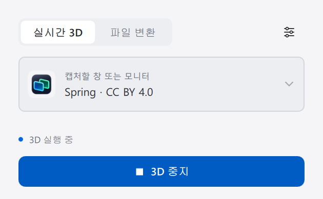
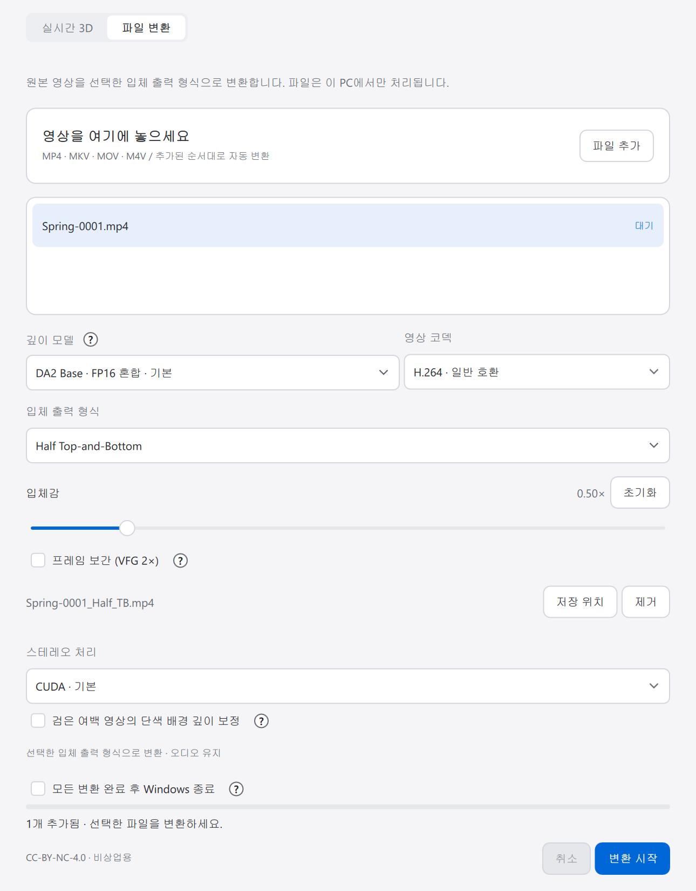
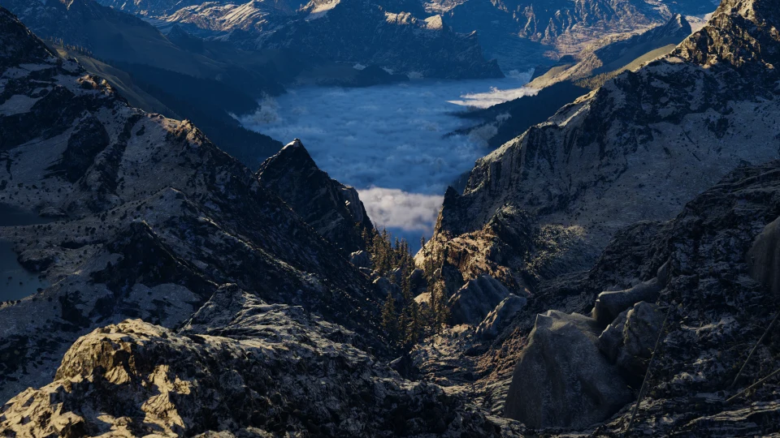
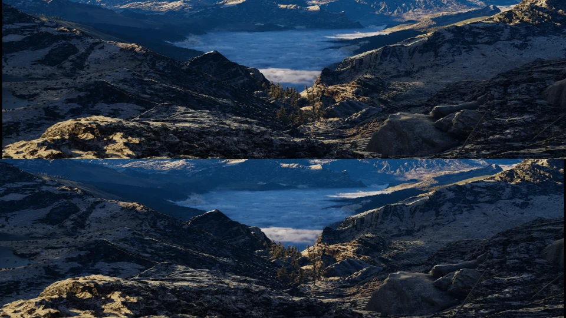

# ScreenTo3D

[English](README.md) | **한국어**

게임·영상 화면을 실시간 3D로 변환하고, 영상 파일도 입체 영상으로 변환합니다. 준비된 로컬
환경에서 `ScreenTo3D.exe`를 실행하면 한국어·영어를 지원하는 실시간 3D / 파일 / 설정
앱이 열립니다. 실시간 처리와 파일 변환은 선택한 처리 모드에 맞는 설치된 깊이
모델을 사용하며, 다른 모델로 자동 대체하지 않습니다. 최신 소스의 기능이 기존
포터블 배포본에 자동으로 반영되지는 않습니다.

## 앱 화면

창이나 모니터를 선택하고 실시간 3D를 시작합니다. 아래는 공개 Spring 장면을
입력으로 DA2 Small·Half Top-and-Bottom 출력을 실제 실행 중인 화면입니다.



<details>
<summary>파일 변환: 대기열·입체감·선택적 VFG</summary>

영상을 추가하고 출력 형식을 선택한 뒤 변환을 시작합니다. 파일 설정은 기본으로
모두 표시됩니다. 최초 모델은 DA2 Base, 입체감은 0.5이며 VFG와 변환 완료 후
Windows 종료는 기본으로 꺼져 있습니다.



</details>

**설정 및 진단 → 언어**에서 시스템 기본값, 한국어, English를 선택할 수 있습니다.
선택 값은 저장되며 실시간 3D 실행 중에도 언어를 바꿀 수 있습니다.

[현재 데스크톱 포터블 배포 구성](docs/models/desktop-distribution.md)은 DA2 Small을
기본 동봉하고, Base·VDA Small·선택 기능인 NVIDIA VFG는 필요할 때 설치합니다.
Small·Base·VDA의 TensorRT 엔진은 사용자의 NVIDIA GPU에서 생성합니다.

목표는 Small + Lossless Scaling FG보다 나은 깊이 품질과 사용성, 눈당 3840×2160 /
Full SBS 7680×2160 해상도에서 최종 60fps 출력입니다. 검증이 완료된 지원 사양은 아닙니다.

## Half Top-and-Bottom 예제

같은 프레임의 원본과 실제 네이티브 입체 변환 결과입니다. **DA2 Small FP16 ·
입체감 0.5 · VFG 꺼짐**으로 생성했습니다. 기본 편안함 보정을 포함한 일반 실시간
설정을 사용했으며, 벤치마크용 카메라 맞춤 보정은 적용하지 않았습니다.

| 원본 2D 입력 | Half Top-and-Bottom 출력 |
|---|---|
| [](docs/images/spring-original.png) | [](docs/images/spring-half-tb.png) |

미리보기를 누르면 **1920×1080 PNG**를 열 수 있습니다. 출력은 위쪽에 왼눈,
아래쪽에 오른눈을 각각 **1920×540**으로 저장합니다. 일반 2D 페이지에서 두 영상이
세로로 압축되어 보이는 것이 정상입니다. 출력 PNG를 내려받고 대응하는 입체 이미지
뷰어나 3D 디스플레이에서 **Half Top-and-Bottom**을 선택하면 각 눈의 비율이 복원되어
입체로 볼 수 있습니다.

출처: [Spring 데이터셋, DaRUS V2](https://doi.org/10.18419/DARUS-3376),
Mehl·Schmalfuss·Jahedi·Nalivayko·Bruhn(2023);
장면 에셋: [Spring, Blender Foundation / Blender Studio](https://studio.blender.org/films/spring/).
[CC BY 4.0](https://creativecommons.org/licenses/by/4.0/).
변경 사항: ScreenTo3D 입체 변환 및 웹 미리보기 축소.
[이미지 출처와 재현 방법](docs/images/README.md).

## RGB 화질 평가 (2026-11-10)

네이티브 Full SBS와 Half TB를 두 종류의 기준 영상으로 평가했습니다. 직접 구성한
3D 장면 4개는 중앙 카메라 영상을 입력하고 좌우 카메라의 정답 영상과 비교했으며,
Spring 장면 4개는 왼쪽 카메라 영상을 입력하고 원래 오른쪽 카메라 영상과 비교했습니다.
Spring 점수는 생성한 오른쪽 눈 영상만 평가합니다. RTX 5090과 현재의 FP16 / 혼합
FP16 모델을 사용했고, 채점 전에 보정을 고정했으며 각 장면에 같은 가중치를 부여했습니다.

**Spring Half TB, 논리적 눈당 해상도 1920×1080:** PSNR·SSIM은 높을수록,
LPIPS는 낮을수록 좋습니다. LPIPS는 AlexNet v0.1을 사용합니다.

| 모델 | PSNR (dB) ↑ | SSIM ↑ | LPIPS ↓ |
|---|---:|---:|---:|
| DA2 Small | 25.745 | 0.7706 | 0.10546 |
| DA2 Base | **27.091** | 0.7948 | 0.09836 |
| VDA Small | 26.676 | 0.8022 | 0.09938 |
| oVDA c16 (실험적) | 26.738 | **0.8032** | **0.09751** |

Base·VDA·oVDA는 Spring Half TB의 모든 장면에서 세 가지 전체 영상 지표가 모두
Small보다 좋았습니다. Base는 평균 경계·배경 RGB 오차가 가장 작았고, oVDA는 평균
SSIM이 가장 높고 LPIPS가 가장 낮았습니다. 순위는 영상 내용에 따라 달라집니다.
직접 구성한 양안 장면에서는 Small의 PSNR이 가장 높았습니다. 각 4개 장면으로는
Base·VDA·oVDA 중 어느 모델이 전반적으로 가장 좋다고 단정할 수 없습니다.

기준 카메라와 조건을 맞추기 위해 이 진단 실행에서는 시차 압축과 화면 가장자리
마스크를 끄고, 보정한 투영 배율과 수렴값을 고정했습니다. 앱 기본값은 바꾸지 않았습니다.
따라서 이 RGB 결과는 기본 설정 그대로의 입체 기하, 실시간 FPS, 실제 시청 시의
눈의 편안함을 평가한 결과가 아닙니다.

[전체 결과·두 출력 형식·검증 범위](docs/evidence/sbs-rgb-quality-20261110.md)와
[측정·재현 방법](docs/BENCHMARKS.md#full-reference-native-sbs-rgb)을 참고하세요.
Spring 데이터: [Mehl 외 (2023), DaRUS V2](https://doi.org/10.18419/DARUS-3376),
CC BY 4.0.

## 문서

- [제품 동작과 목표](docs/PRODUCT.md)
- [현재 처리 경로·측정 결과·미통과 검증 항목](docs/implementation-status.md)
- [작업 목록](docs/ROADMAP.md)
- [아키텍처](ARCHITECTURE.md)
- [언어와 오류 메시지 추가 방법](docs/LOCALIZATION.md)
- [보안](docs/SECURITY.md), [신뢰성](docs/RELIABILITY.md), [측정 방법](docs/BENCHMARKS.md)
- [과거 검증 자료](docs/evidence/README.md). 모델 설치 문서 링크는 PRODUCT에 있습니다.

## Windows 빌드와 테스트

`python scripts/build-translations.py --check`로 소스의 번역 카탈로그를 검증합니다.
포터블 빌드 도구는 등록된 모든 Qt 번역 카탈로그를 자동으로 컴파일해 포함합니다.
영어는 번역 카탈로그가 없을 때 사용하는 원문 언어입니다.

필요한 도구:

- MSVC x64 도구 모음이 설치된 Visual Studio
- Visual Studio에 포함된 CMake와 Ninja
- 실시간 기능 확인을 위한 NVIDIA 디스플레이 드라이버
- 영상 처리를 위한 FFmpeg와 ffprobe (`PATH`에 등록)

도우미 스크립트는 `vswhere`로 Visual Studio를 찾고 개발 환경을 초기화합니다.

```powershell
powershell -NoProfile -ExecutionPolicy Bypass -File .\scripts\dev.ps1 -Action check
```

Release 구성의 기능 확인:

```powershell
powershell -NoProfile -ExecutionPolicy Bypass -File .\scripts\dev.ps1 `
  -Action capability -Configuration Release
```

빌드 결과는 `out/build/` 아래에 저장되며 Git 추적 대상에서 제외됩니다.

## CLI

```text
depthsbs capability [--compact]
depthsbs mode <performance|balanced|video-quality|offline-quality> [--compact]
```

모든 모드는 현재 실험적 기능으로 표시됩니다. 모드별 프레임 속도는 벤치마크
목표이며, 지원을 보장하는 수치가 아닙니다.
