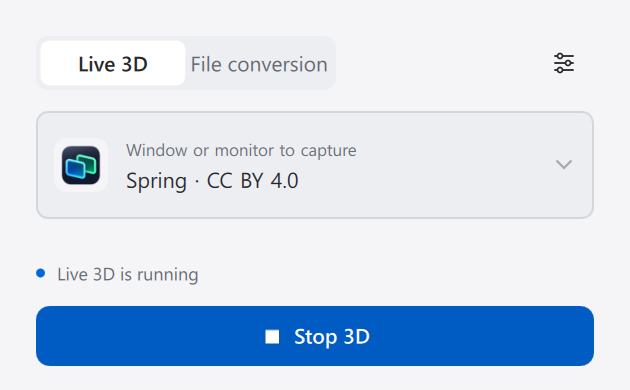
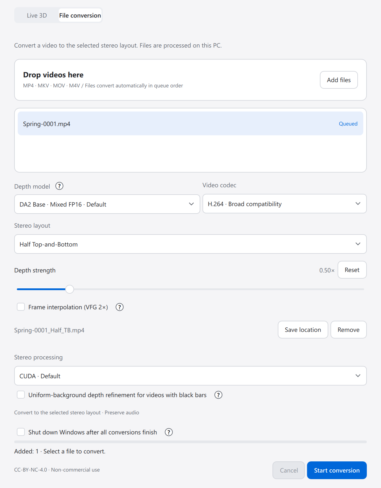
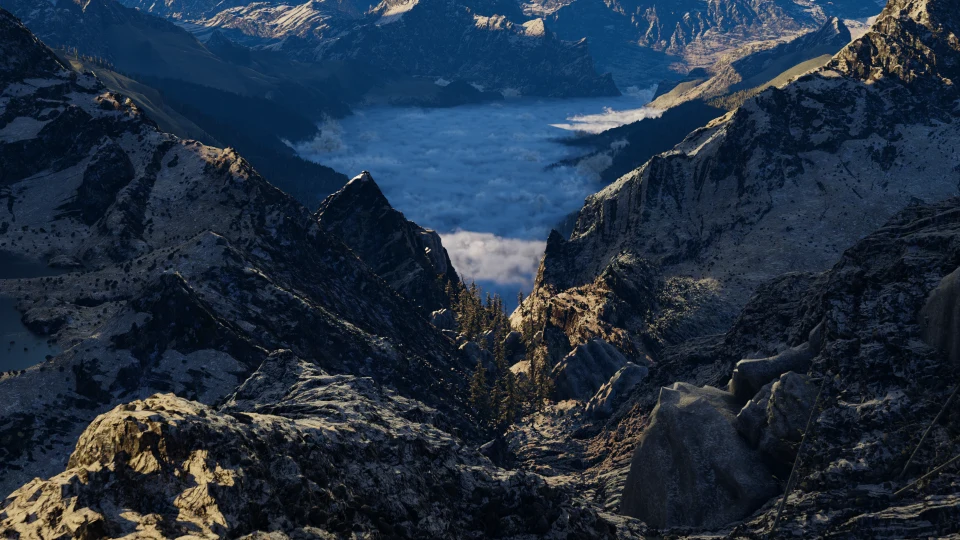
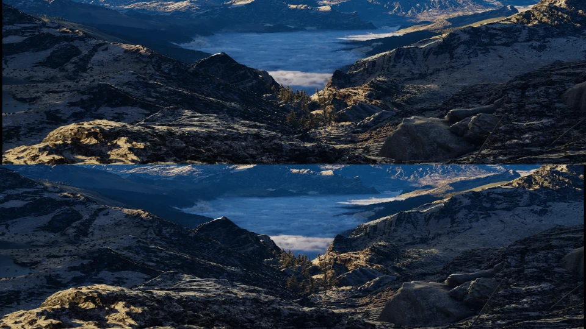

# ScreenTo3D

**English** | [한국어](README.ko.md)

**[Download Windows app ZIP](https://github.com/lesser-vr/ScreenTo3D/releases/download/v1.0.0/ScreenTo3D-1.0.0-windows-x64.zip)** ·
[Runtime packs and release](https://github.com/lesser-vr/ScreenTo3D/releases/tag/v1.0.0) ·
[Installation instructions](docs/releases/1.0.0.md)

Extract the ZIP and run `ScreenTo3D.exe`. The app identifies the additional packs needed for first 3D use.

Real-time 2D-to-3D conversion for games and videos, plus stereo video file conversion.
Run `ScreenTo3D.exe` in the prepared local environment for the Korean/English
Live 3D / Files / Settings app. Live and
file conversion resolve the selected product mode to its permitted installed depth
model without silent fallback. Current source features are not automatically in
old portable builds.

## App UI

Select a window or monitor and start Live 3D. This is the actual app running with
the public Spring scene as its input, using DA2 Small and Half Top-and-Bottom.



<details>
<summary>File conversion: queue, depth strength and optional VFG</summary>

Add videos to the queue, choose an output layout, then start conversion. File
settings are always visible; DA2 Base is the initial file model, depth strength
starts at 0.5, and VFG and shutdown after conversion start off.



</details>

Choose **Settings and diagnostics → Language** to use the system language,
한국어 or English. The selection is saved and can change while Live 3D is running.

The [current desktop portable build](docs/models/desktop-distribution.md) bundles
DA2 Small and installs Base, VDA Small and optional NVIDIA VFG on demand.
Small, Base and VDA build their TensorRT engines on the user's NVIDIA GPU.

The refreshed 1.0.0 portable build keeps preferences in `data/settings.ini` and models,
runtimes, caches and logs under `data/` beside the EXE. Settings shows the data
location and opens its folder. Previous AppData files are not imported or removed.
Move the whole app folder and preserve `data/` when updating.

The goal is better depth and easier use than Small + Lossless Scaling FG, with
3840x2160 per eye / 7680x2160 Full SBS at final 60 fps. This is not certified support.

## Half Top-and-Bottom example

The same frame before and after native stereo conversion: **DA2 Small FP16 ·
depth strength 0.5 · VFG off**. The output uses the ordinary live settings,
including the default comfort processing, without benchmark camera calibration.

| Original 2D input | Half Top-and-Bottom output |
|---|---|
| [](docs/images/spring-original.png) | [](docs/images/spring-half-tb.png) |

Click either preview for its **1920×1080 PNG**. The output contains the left eye
on top and the right eye below, each stored at **1920×540**. Two vertically
compressed views are expected on a normal 2D page. Download the output PNG and
select **Half Top-and-Bottom** in a compatible stereoscopic image viewer or 3D
display to restore each eye's proportions and view it in 3D.

Source: [Spring dataset, DaRUS V2](https://doi.org/10.18419/DARUS-3376),
Mehl, Schmalfuss, Jahedi, Nalivayko and Bruhn (2023); scene assets from
[Spring, Blender Foundation / Blender Studio](https://studio.blender.org/films/spring/).
[CC BY 4.0](https://creativecommons.org/licenses/by/4.0/).
Changes: stereo synthesis by ScreenTo3D and reduced web previews.
[Image provenance and reproduction](docs/images/README.md).

## RGB quality evaluation (2026-11-10)

Native Full SBS and Half TB were evaluated with two references: four procedural
3D scenes with center-input / left-and-right ground truth, and four Spring scenes
with left-camera input / original right-camera ground truth. Spring scores cover
the generated right eye only. Measurements used an RTX 5090, current FP16/mixed-
FP16 models, fixed calibration before scoring, and equal weight per scene.

**Spring Half TB, 1920x1080 logical eye:** higher PSNR/SSIM and lower LPIPS are
better. LPIPS uses AlexNet v0.1.

| Model | PSNR (dB) ↑ | SSIM ↑ | LPIPS ↓ |
|---|---:|---:|---:|
| DA2 Small | 25.745 | 0.7706 | 0.10546 |
| DA2 Base | **27.091** | 0.7948 | 0.09836 |
| VDA Small | 26.676 | 0.8022 | 0.09938 |
| oVDA c16 (experimental) | 26.738 | **0.8032** | **0.09751** |

Base, VDA and oVDA improved all three global metrics over Small in every Spring
Half TB scene. Base had the lowest mean boundary/background RGB errors; oVDA
had the highest mean SSIM and lowest LPIPS. Rankings vary with the content:
Small had the highest PSNR on the procedural binocular scenes. The four-scene
samples do not establish a universal winner among Base, VDA and oVDA.

To match reference cameras, these diagnostic runs disabled disparity compression
and window-edge masks, then froze the fitted projection scale/convergence.
Application defaults were unchanged. These calibrated RGB results do not measure
unchanged-default geometry, real-time FPS or physical viewing comfort.

See [full results, both formats and validation](docs/evidence/sbs-rgb-quality-20261110.md)
and [measurement/reproduction methods](docs/BENCHMARKS.md#full-reference-native-sbs-rgb).
Spring data: [Mehl et al. (2023), DaRUS V2](https://doi.org/10.18419/DARUS-3376),
CC BY 4.0.

## Documentation

- [Product behavior and target](docs/PRODUCT.md)
- [Current paths, measurements and unpassed acceptance](docs/implementation-status.md)
- [Work areas](docs/ROADMAP.md)
- [Architecture](ARCHITECTURE.md)
- [Adding languages and error messages](docs/LOCALIZATION.md)
- [Security](docs/SECURITY.md), [reliability](docs/RELIABILITY.md), [measurement methods](docs/BENCHMARKS.md)
- [Historical evidence](docs/evidence/README.md); model setup links are in PRODUCT.

## Build and test on Windows

Validate the source translation catalog with `python scripts/build-translations.py --check`.
The portable builder compiles and includes all registered Qt translation catalogs
automatically; English is the source-language fallback.

Requirements:

- Visual Studio with the MSVC x64 toolchain;
- Visual Studio's bundled CMake and Ninja;
- an NVIDIA display driver for the live capability probe;
- FFmpeg and ffprobe on `PATH` for media work.

The helper locates Visual Studio through `vswhere` and initializes its developer
environment:

```powershell
powershell -NoProfile -ExecutionPolicy Bypass -File .\scripts\dev.ps1 -Action check
```

Release capability probe:

```powershell
powershell -NoProfile -ExecutionPolicy Bypass -File .\scripts\dev.ps1 `
  -Action capability -Configuration Release
```

The build output is written under `out/build/` and is ignored by git.

## CLI

```text
screento3d capability [--compact]
screento3d mode <performance|balanced|video-quality|offline-quality> [--compact]
```

All modes are currently marked experimental. Their frame-rate numbers are
benchmark targets, not support claims.
